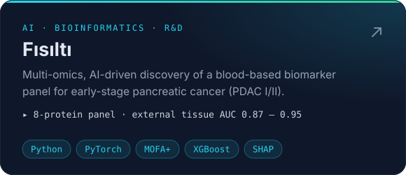
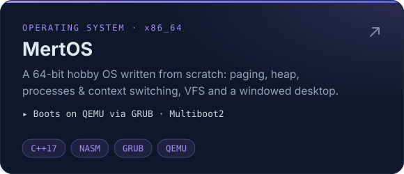
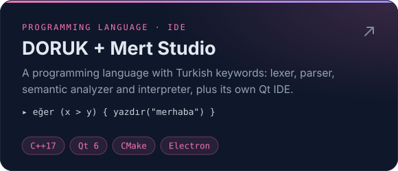
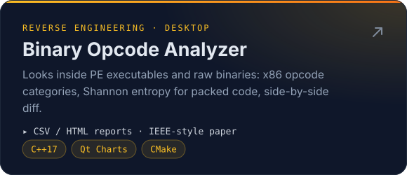
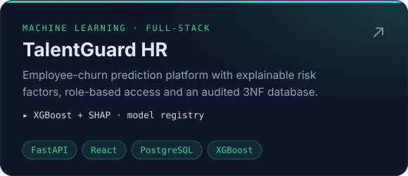
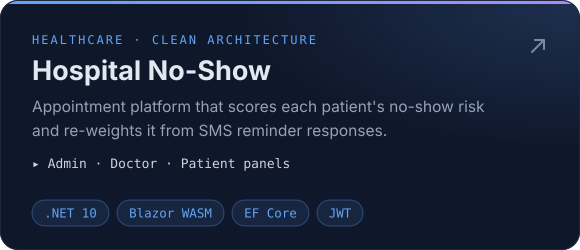
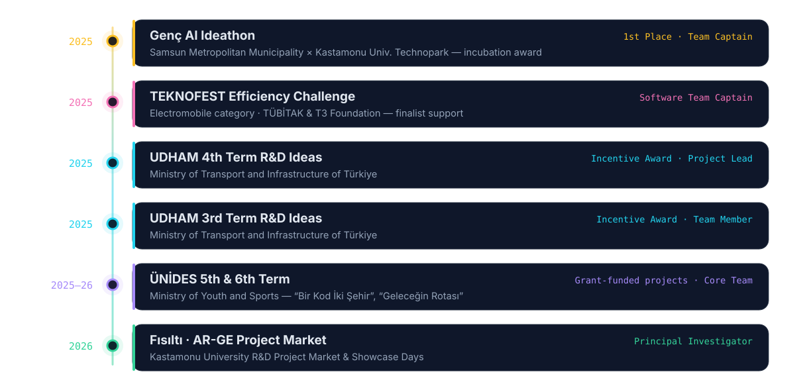

<div align="center">



<br/>

<a href="mailto:mertyasinyilmaz26@gmail.com"></a>&nbsp;<a href="https://www.linkedin.com/in/mert-yasin-yilmaz-7b58a6220/"></a>&nbsp;<a href="https://github.com/Soap2647?tab=repositories"></a>

</div>

<br/>

## 👋 About me

I'm a **Computer Engineering student at Kastamonu University** who likes building things from the ground up: an operating system kernel, a programming language with Turkish keywords, or a machine-learning pipeline that searches multi-omics data for early signs of pancreatic cancer.

Most of my work sits where **AI meets real-world problems** (health, HR, transport) and where **low-level systems** meet clean, usable interfaces. I lead teams in national competitions and R&D programmes, and I care about reproducible, honestly reported results.

```yaml
focus:      [AI/ML for healthcare, bioinformatics, systems programming, full-stack apps]
now:        Fısıltı · blood-based biomarker panel for early-stage pancreatic cancer
exploring:  quantum algorithms (QAOA), autonomous-driving software, compilers
languages:  { Turkish: native, English: B2, German: B1 }
```


## 🚀 Featured projects

<p align="center">
<a href="https://github.com/Soap2647/Fisilti"></a>&nbsp;<a href="https://github.com/Soap2647/Operating-System"></a>
<br/>
<a href="https://github.com/Soap2647/Mert-Studio-Code-v2"></a>&nbsp;<a href="https://github.com/Soap2647/Binary-Opcode-Analyzer"></a>
<br/>
<a href="https://github.com/Soap2647/TalentGuard-HR"></a>&nbsp;<a href="https://github.com/Soap2647/Hospital-No-Show"></a>
</p>

<details>
<summary><b>More projects</b></summary>
<br/>

| Project | What it is | Stack |
|---|---|---|
| [**Nebula PDF**](https://github.com/Soap2647/nebulapdf) | In-browser PDF editor: edit text, remove images, export, all on the client | React · Vite · pdf.js · pdf-lib |
| [**Aşkımla – Watch Together**](https://github.com/Soap2647/dizi-film) | Room-code screen sharing over WebRTC P2P with live emoji and GIF reactions | React · Socket.IO · WebRTC |
| [**Conference Management**](https://github.com/Soap2647/Conference-Management) | Paper submission and peer-review workflow with role-based access | ASP.NET Core MVC · Identity · EF Core |
| [**Geometry Wars**](https://github.com/Soap2647/Geometry-Wars) | Neon arcade shooter with particle effects, a warping grid and enemy AI | Python · Pygame |
| [**Tower Defense**](https://github.com/Soap2647/Tower-Defense) | Wave-based strategy game with three tower types and an in-game economy | Python · Pygame |
| [**Mert Studio Code (web)**](https://github.com/Soap2647/Mert-Studio-Code) | The first, web-based editor for the DORUK language | React · Vite · Electron |
| [**WakeBreaker Web**](https://github.com/Soap2647/wakebreaker_web) | Landing page and web client for the WakeBreaker alarm app | Flutter Web · Dart |
| [**Academic Projects**](https://github.com/Soap2647/Academic-Projects) | Archive of HTML/CSS and PHP + MySQL coursework | HTML · CSS · PHP · MySQL |
| [**Research Assignments**](https://github.com/Soap2647/Research-Assignments) | Short papers on network and web security topics | PDF |

</details>


## 🏆 Awards & grant-funded projects



## 🎓 Education

<table>
  <tr>
    <td><b>Kastamonu University</b><br/><sub>B.Sc. Computer Engineering</sub></td>
    <td align="right"><code>2024 – present</code></td>
  </tr>
</table>


## 🧰 Tech stack

<p align="center">
  <b>Languages</b><br/><br/>
  
</p>
<p align="center">
  <b>Frameworks & libraries</b><br/><br/>
  
</p>
<p align="center">
  <b>Data, tools & platforms</b><br/><br/>
  
</p>

<p align="center">
  
  
  
  
  
  
  
  
  
  
  
</p>


## 📈 Activity

<p align="center">
  <picture>
    <source media="(prefers-color-scheme: dark)" srcset="https://raw.githubusercontent.com/Soap2647/Soap2647/output/snake-dark.svg"/>
    <source media="(prefers-color-scheme: light)" srcset="https://raw.githubusercontent.com/Soap2647/Soap2647/output/snake-light.svg"/>
    
  </picture>
</p>

<details>
<summary><b>🇹🇷 Türkçe özet</b></summary>
<br/>

Kastamonu Üniversitesi **Bilgisayar Mühendisliği** öğrencisiyim. Sıfırdan bir işletim sistemi çekirdeği, Türkçe anahtar kelimeli bir programlama dili ya da çoklu-omik veride pankreas kanserinin erken izlerini arayan bir yapay zekâ hattı gibi işleri temelden kurmayı seviyorum.

- **Şu an:** Fısıltı, erken evre pankreas kanseri için kan tabanlı biyobelirteç paneli (Kastamonu Üniversitesi AR-GE Proje Pazarı, yürütücü)
- **Genç AI Ideathon:** Birincilik, takım kaptanı (Samsun Büyükşehir Belediyesi × Kastamonu Üniversitesi Teknopark)
- **TEKNOFEST Efficiency Challenge (Elektromobil):** Yazılım ekibi takım kaptanı
- **UDHAM 3. ve 4. Dönem Ar-Ge Fikir Yarışması:** Teşvik ödülleri (4. dönemde proje yürütücüsü)
- **ÜNİDES 5. ve 6. Dönem:** Gençlik ve Spor Bakanlığı destekli projelerde projeden sorumlu ekip üyesi
- **Diller:** Türkçe (ana dil), İngilizce (B2), Almanca (B1)

</details>

<div align="center">
<br/>
<sub>Thanks for stopping by · Uğradığın için teşekkürler ✦</sub>
</div>
