<div align="center">



<br/>

<a href="mailto:mertyasinyilmaz26@gmail.com"></a>&nbsp;<a href="https://www.linkedin.com/in/mert-yasin-yilmaz-7b58a6220/"></a>&nbsp;<a href="https://github.com/Soap2647?tab=repositories"></a>

</div>

<br/>

## 👋 About me

I'm a **Computer Engineering student at Kastamonu University specialising in machine learning and artificial intelligence**. My main project is a machine-learning pipeline that searches multi-omics data for early signs of pancreatic cancer, and I build explainable models for real-world problems such as healthcare and HR analytics.

I like to understand things from the ground up, which is why I've also written an operating system kernel and a programming language. I care about **reproducible, explainable and honestly reported results**, and I lead teams in national competitions and R&D programmes.

I believe software engineering is becoming **AI direction**: deciding what to build, splitting it into steps, reviewing what agents produce and owning the result. I work that way every day and keep a public [**build log**](https://github.com/Soap2647/ai-build-log) of it.

I also turn what I learn into open-source **Claude Code skills**. The first one, [**tr-akademik-humanizer**](https://github.com/Soap2647/tr-akademik-humanizer), cleans AI-writing patterns out of Turkish academic text such as TÜBİTAK proposals, without inventing citations or touching the numbers.

```yaml
focus:      [machine learning, deep learning, explainable AI, AI for healthcare]
now:        Fısıltı · blood-based biomarker panel for early-stage pancreatic cancer
exploring:  multi-omics integration, attention-based MIL, quantum ML (QAOA)
daily:      ai-build-log · one entry per working day
skills:     tr-akademik-humanizer · Claude Code skill for Turkish academic writing
languages:  { Turkish: native, English: B2, German: B1 }
```

<p align="center"><sub>
<b>29</b> open-source <a href="https://github.com/Soap2647?tab=repositories">repos</a> &nbsp;·&nbsp; <b>9</b> languages &nbsp;·&nbsp; an <b>80-chapter</b> engineering <a href="https://github.com/Soap2647/muhendis-el-kitabi">handbook</a> &nbsp;·&nbsp; an OS kernel and a programming language, from scratch
</sub></p>


## 🛠️ Build log

<sub>What I built by directing AI agents, updated automatically from <a href="https://github.com/Soap2647/ai-build-log">ai-build-log</a>.</sub>

<!-- BUILD-LOG:START -->

| Day | What I built with AI |
|---|---|
| `2026-11-15` | [**Turning my GitHub into a public build log**](https://github.com/Soap2647/ai-build-log/blob/main/log/2026/2026-11-15.md)<br/><sub>Audited 55 local projects with an AI agent, scrubbed leaked keys, open-sourced 10 projects under MIT and started this log.</sub> |

<!-- BUILD-LOG:END -->


## 🎓 Education

<table>
  <tr>
    <td><b>Kastamonu University</b><br/><sub>B.Sc. Computer Engineering</sub></td>
    <td align="right"><code>2024 – present</code></td>
  </tr>
</table>


## 🧰 Tech stack

<p align="center">
  
</p>


## 📈 Activity

<p align="center">
  <picture>
    <source media="(prefers-color-scheme: dark)" srcset="https://raw.githubusercontent.com/Soap2647/Soap2647/output/snake-dark.svg"/>
    <source media="(prefers-color-scheme: light)" srcset="https://raw.githubusercontent.com/Soap2647/Soap2647/output/snake-light.svg"/>
    
  </picture>
</p>

<details>
<summary><b>🇹🇷 Türkçe özet</b></summary>
<br/>

Kastamonu Üniversitesi **Bilgisayar Mühendisliği** öğrencisiyim ve **makine öğrenmesi ile yapay zekâ** alanında uzmanlaşıyorum. Ana projem, çoklu-omik veride pankreas kanserinin erken izlerini arayan bir makine öğrenmesi hattı. Sağlık ve İK gibi gerçek dünya problemleri için açıklanabilir modeller geliştiriyorum.

- **Şu an:** Fısıltı, erken evre pankreas kanseri için kan tabanlı biyobelirteç paneli (Kastamonu Üniversitesi AR-GE Proje Pazarı, yürütücü)
- **Çalışma şeklim:** Yazılım mühendisliğinin yapay zekâ direktörlüğüne döndüğünü düşünüyorum: neyin yapılacağına karar vermek, işi adımlara bölmek, ajanların çıktısını denetlemek ve sonucun sahibi olmak. Her gün böyle çalışıyorum ve ne inşa ettiğimi [build log](https://github.com/Soap2647/ai-build-log)'da paylaşıyorum.
- **Claude skill'leri:** Türkçe akademik metinlerdeki (ör. TÜBİTAK önerileri) yapay zekâ izlerini kaynak uydurmadan ve sayılara dokunmadan temizleyen [tr-akademik-humanizer](https://github.com/Soap2647/tr-akademik-humanizer).
- **Rakamlarla:** 29 açık kaynak repo, 80 bölümlük bir mühendislik [el kitabı](https://github.com/Soap2647/muhendis-el-kitabi), sıfırdan yazılmış bir işletim sistemi çekirdeği ve bir programlama dili.
- **Diller:** Türkçe (ana dil), İngilizce (B2), Almanca (B1)

</details>

<div align="center">
<br/>
<sub>Thanks for stopping by · Uğradığın için teşekkürler ✦</sub>
</div>
